# Guide de démarrage

*[English version](getting-started.md)*

De l'installation à la première carte, en une dizaine de minutes. Les captures montrent un logement inventé.

## Avant de commencer

Il vous faut :

- **Home Assistant 2026.11 ou plus récent** (en 2026.10, passez par [HACS](https://hacs.xyz)) ;
- **une mesure de la consommation du logement** déjà présente dans Home Assistant. C'est la seule chose obligatoire. Elle peut venir :
  - d'un appareil en temps réel : pince ampèremétrique, module de tableau, téléinformation du compteur ;
  - des données de votre distributeur ou fournisseur (Linky par Enedis, par exemple), qui arrivent le lendemain.

Tout le reste (prix, abonnement, météo, chauffage) est facultatif et peut être ajouté plus tard.

## 1. Installer

1. Ouvrez *Paramètres → Marketplace*, puis *Ajouter grâce à un lien*.
2. Collez `https://github.com/Amify-Studio/wattendix` et validez. La première fois, Home Assistant vous demande de connecter un compte GitHub : suivez le lien affiché et saisissez le code.
3. Ouvrez **Wattendix**, puis *Installer*. Pas besoin de redémarrer : l'assistant de configuration s'ouvre aussitôt.

En 2026.10, avec HACS : menu ⋮ → *Dépôts personnalisés*, ajoutez la même adresse en type *Intégration*, installez **Wattendix**, redémarrez, puis *Paramètres → Appareils et services → Ajouter une intégration → Wattendix*.

## 2. Configurer l'intégration

L'assistant ne montre que les écrans utiles à vos choix. Pour ajouter un second compteur plus tard : *Paramètres → Appareils et services → Ajouter une intégration → Wattendix*.

### Ce que vous avez

Le premier écran pose trois questions : comment arrive la consommation, si vous voulez des montants en euros, et si vous voulez y inclure l'abonnement.

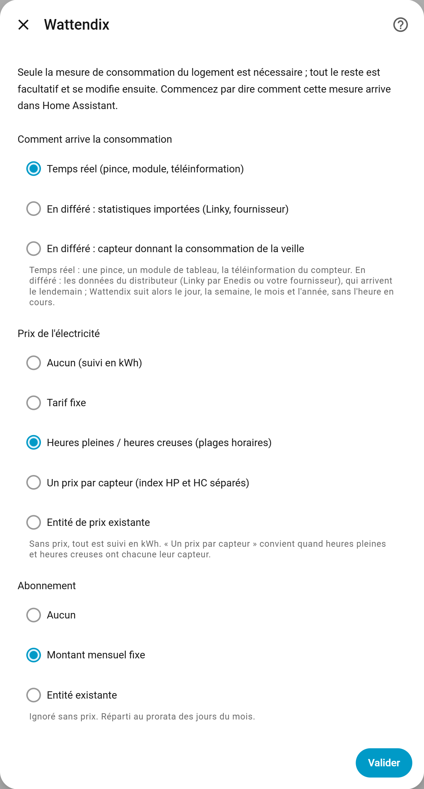

| Votre situation | Choisissez |
| --- | --- |
| Pince, module de tableau, téléinformation | *Temps réel* |
| Données Linky ou fournisseur visibles dans le tableau de bord Énergie | *En différé : statistiques importées* |
| Un capteur qui donne « la consommation d'hier » | *En différé : capteur donnant la consommation de la veille* |

En différé, Wattendix suit le dernier jour reçu, la semaine, le mois et l'année ; il n'y a pas d'heure en cours ni de plages horaires.

### La mesure de consommation

Choisissez le ou les capteurs qui mesurent le logement ; plusieurs sont additionnés (trois phases, index heures pleines + heures creuses…). Avec du solaire, prenez le compteur d'import réseau.

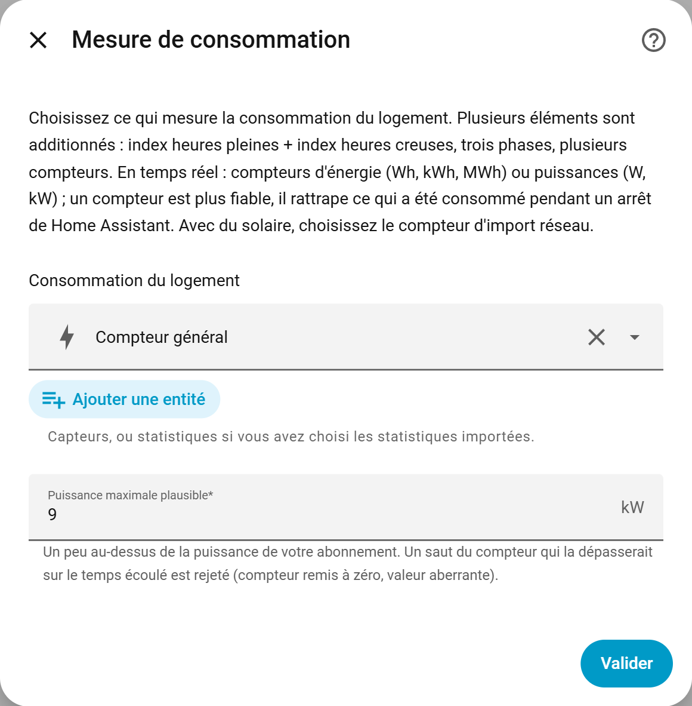

La *puissance maximale plausible* protège vos compteurs : un saut du capteur qui la dépasserait est ignoré. Mettez un peu plus que la puissance de votre abonnement (9 kW pour un abonnement de 6 kVA, par exemple).

### Le prix

Selon votre choix du premier écran : un tarif fixe, des heures pleines et creuses avec leurs plages, un prix par capteur, ou une entité de prix que vous avez déjà.

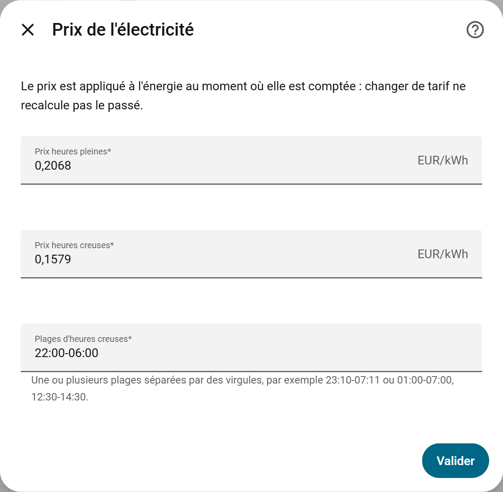

Le prix est appliqué au moment où l'énergie est consommée. Quand votre tarif change, modifiez-le ici : le passé n'est pas recalculé.

### L'abonnement

Le montant mensuel de votre abonnement, pour que les montants affichés ressemblent à votre facture. Il est réparti sur les jours du mois.

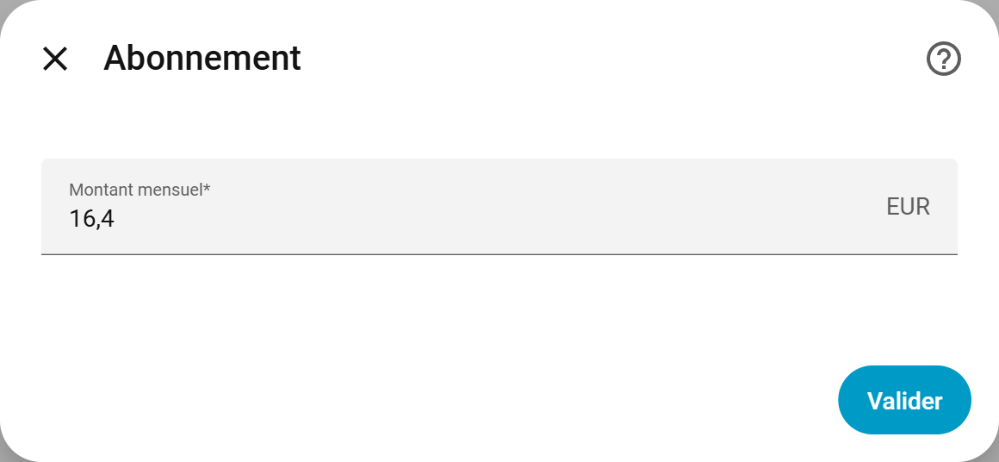

### La météo

Facultatif, mais c'est ce qui rend les estimations bien meilleures dans un logement chauffé à l'électricité. L'idéal est de donner les deux :

- le **thermomètre extérieur** a un historique : Wattendix apprend tout de suite sur ce que Home Assistant a déjà enregistré ;
- l'**entité météo** fournit les prévisions des jours à venir.

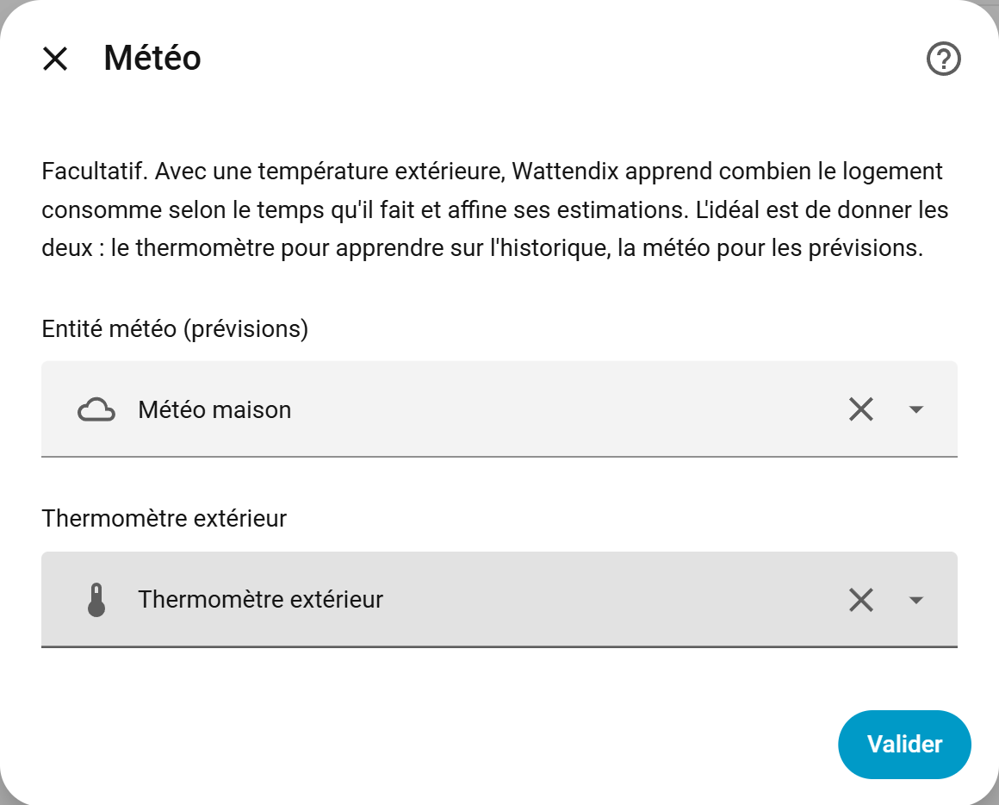

### Le chauffage

Facultatif. Avec la consommation de votre pompe à chaleur ou de vos radiateurs, Wattendix la compare à ce qui est attendu pour le froid qu'il a fait.

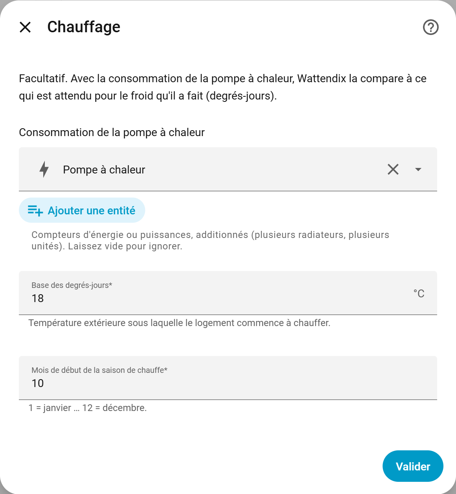

Tout se modifie ensuite par *Configurer*, sur la page de l'intégration, sans perdre les compteurs.

## 3. Ajouter la carte

Sur un tableau de bord : *Modifier → Ajouter une carte → Wattendix*. Il n'y a rien à ajouter dans les ressources, la carte est fournie par l'intégration. Si elle n'apparaît pas dans la liste, rechargez la page du navigateur.

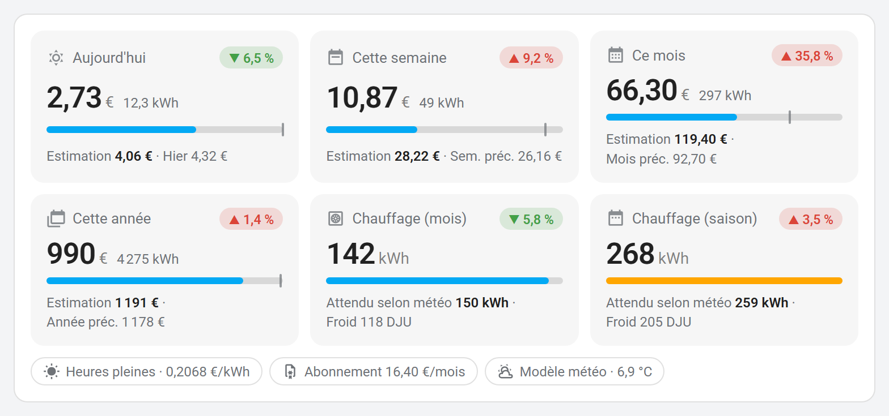

Chaque tuile montre le montant en cours, une barre qui avance vers l'estimation (le petit repère marque la période précédente), et la tendance par rapport à la période précédente. Un appui ouvre l'historique.

L'éditeur visuel propose trois dispositions et quelques options :

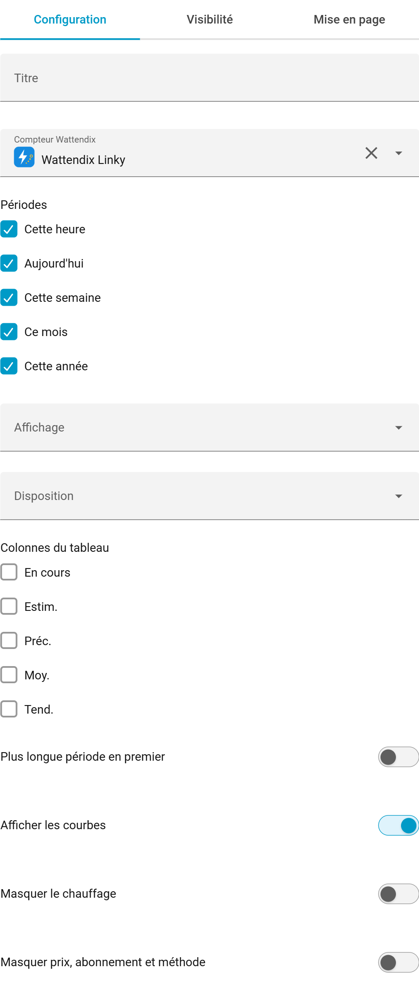

| Disposition | Rendu |
| --- | --- |
| **Tuiles** avec *Afficher les courbes* | 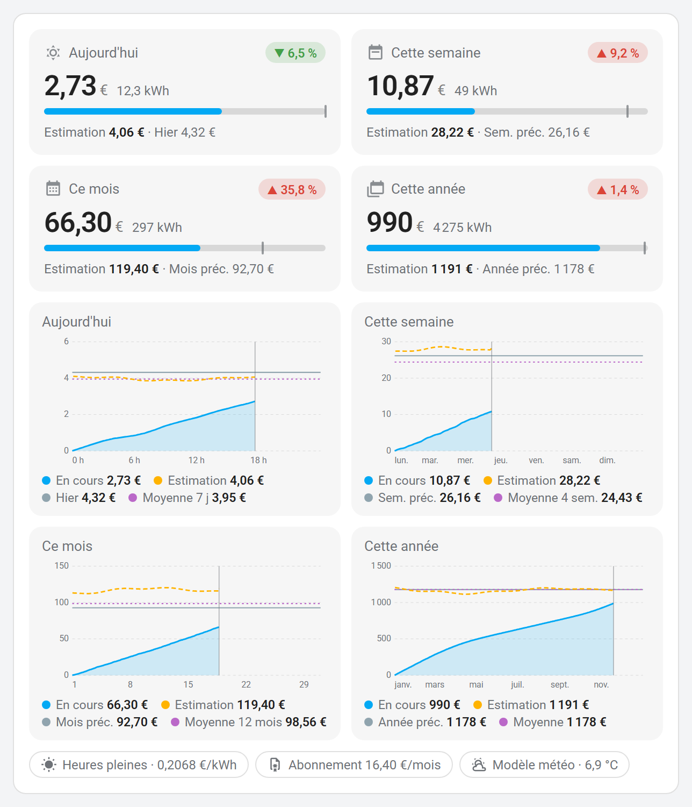 |
| **Tableau résumé** | 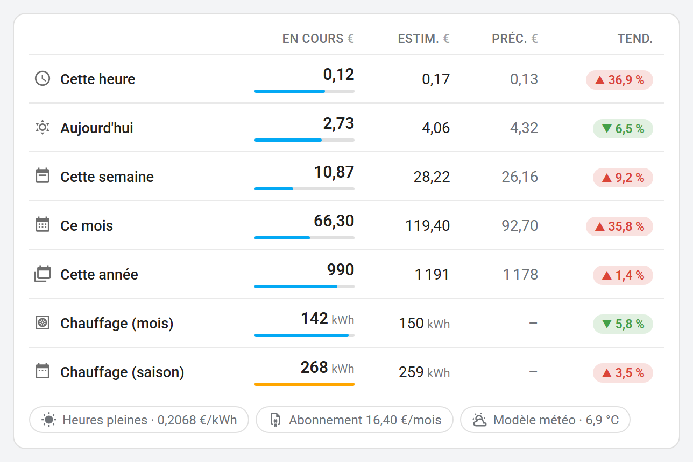 |
| **Mini tableau** | 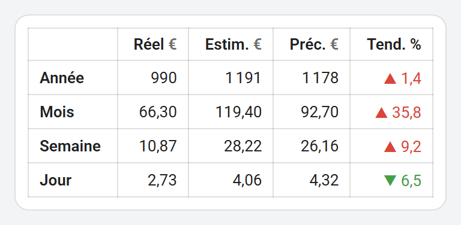 |

Sur les courbes : en bleu ce qui est consommé, en pointillés orange l'estimation au fil du temps, en gris la période précédente, en violet la moyenne.

La carte s'adapte à ce que vous avez configuré :

| Sans prix | En différé (Linky) | Sur téléphone, thème sombre |
| --- | --- | --- |
| 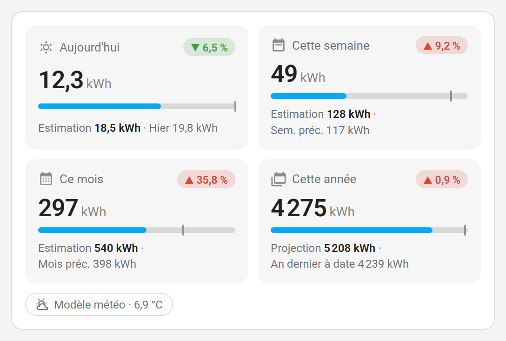 | 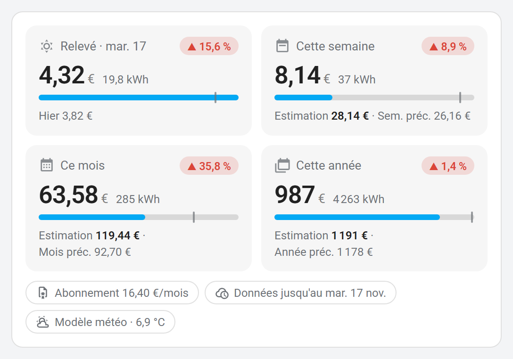 | 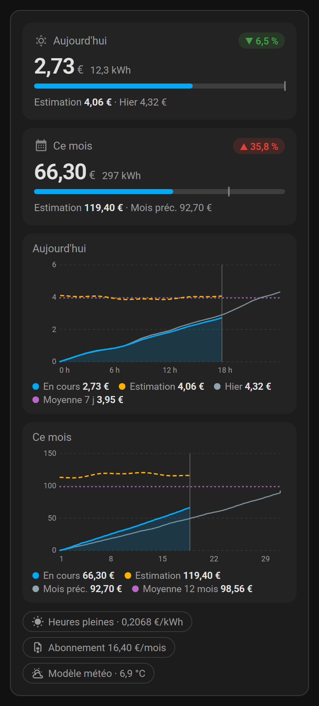 |

## 4. Les premiers jours

- **Les compteurs sont remplis dès l'installation** : Wattendix reprend l'historique de Home Assistant pour les périodes en cours et précédentes. Les coûts de cet historique sont estimés au tarif du jour de l'installation.
- **Le modèle météo demande 14 jours d'historique avec température.** D'ici là, l'estimation du jour utilise la moyenne des 7 derniers jours, et la carte l'indique par une pastille orange « apprentissage ». Avec un thermomètre déjà historisé, le modèle est prêt dès le premier démarrage.
- **Le modèle se réapprend chaque nuit**, sans réglage.

## En cas de souci

| Ce que vous voyez | Ce qu'il faut regarder |
| --- | --- |
| La carte dit que Wattendix n'est pas configuré | L'intégration n'a pas encore été ajoutée (étape 2) |
| La carte n'est pas dans la liste | Rechargez la page ; videz le cache du navigateur si besoin |
| Des montants à zéro ou absents | Le capteur de consommation est-il disponible ? A-t-il la bonne unité (Wh, kWh, MWh, W, kW) ? |
| L'estimation reste sur « Moyenne 7 jours » | Moins de 14 jours d'historique, ou pas de température extérieure |
| Le capteur *Sauts de compteur rejetés* augmente | La puissance maximale plausible est trop basse, ou le capteur source a des ratés |

Un problème, une idée : [ouvrez un ticket](https://github.com/Amify-Studio/wattendix/issues).
