# Getting started

*[Version française](demarrage.md)*

From installation to your first card in about ten minutes. The screenshots show an invented home.

## Before you start

You need:

- **Home Assistant 2026.11 or newer** (on 2026.10, use [HACS](https://hacs.xyz));
- **a measurement of the home's consumption** already in Home Assistant. This is the only requirement. It can come from:
  - a live device: current clamp, panel meter, the meter's own data port;
  - your grid operator's or supplier's data, arriving the next day.

Everything else (price, standing charge, weather, heating) is optional and can be added later.

## 1. Install

1. Open *Settings → Marketplace*, then *Add from link*.
2. Paste `https://github.com/Amify-Studio/wattendix` and confirm. The first time, Home Assistant asks you to connect a GitHub account: follow the link shown and enter the code.
3. Open **Wattendix**, then *Install*. No restart needed: the setup wizard opens right away.

On 2026.10, with HACS: ⋮ menu → *Custom repositories*, add the same address as type *Integration*, install **Wattendix**, restart, then *Settings → Devices & services → Add integration → Wattendix*.

## 2. Set up the integration

The wizard only shows the screens your choices need. To add a second meter later: *Settings → Devices & services → Add integration → Wattendix*.

### What you have

The first screen asks three things: how consumption reaches Home Assistant, whether you want amounts in money, and whether to include the standing charge.

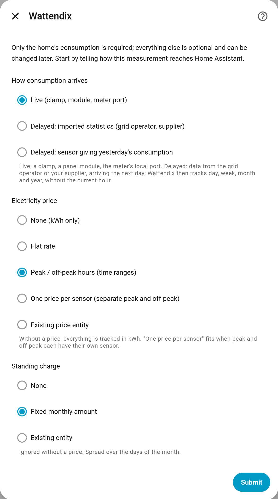

| Your situation | Choose |
| --- | --- |
| Clamp, panel meter, meter data port | *Live* |
| Operator or supplier data shown in the Energy dashboard | *Delayed: imported statistics* |
| A sensor giving "yesterday's consumption" | *Delayed: sensor giving yesterday's consumption* |

With a delayed source, Wattendix tracks the last day received, the week, the month and the year; there is no current hour and no time ranges.

### The consumption measurement

Pick the sensor or sensors that measure the home; several are added together (three phases, peak + off-peak counters…). With solar, pick the grid import meter.

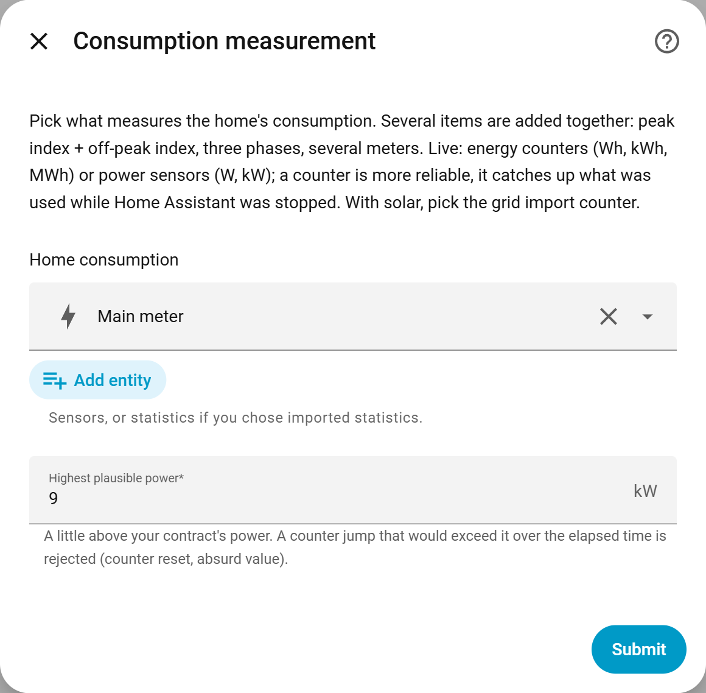

The *highest plausible power* guards your counters: a jump of the sensor beyond it is ignored. Set it a little above your supply rating (9 kW for a 6 kVA supply, for instance).

### The price

Depending on the first screen: a flat rate, peak and off-peak rates with their time ranges, one price per sensor, or a price entity you already have.

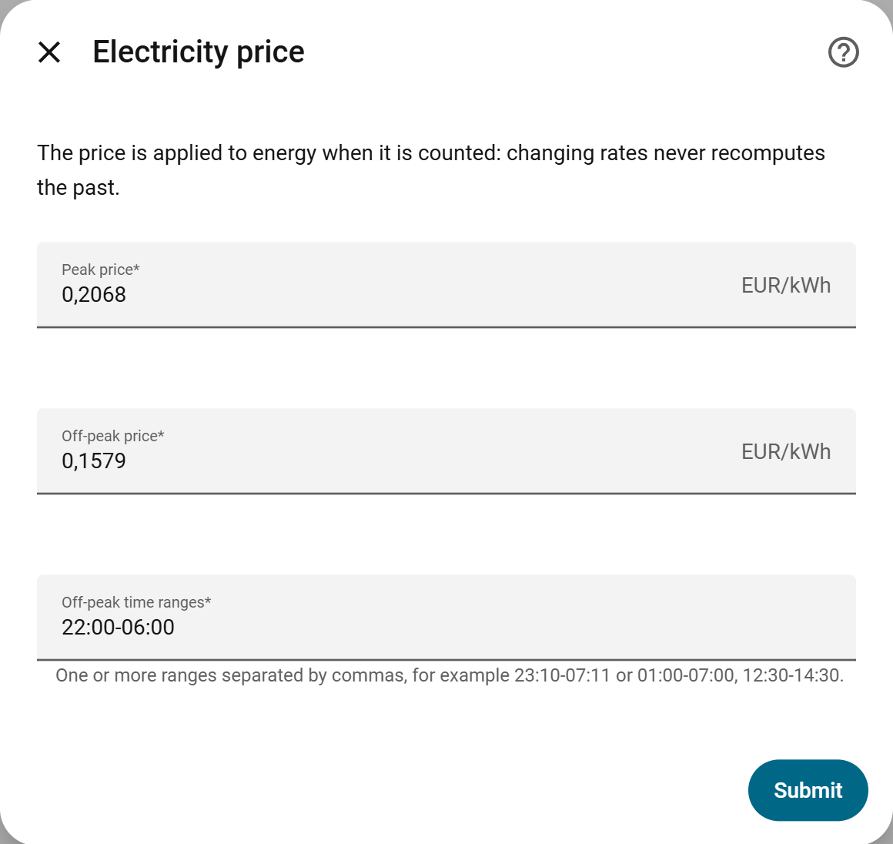

The price applies when the energy is used. When your rate changes, change it here: the past is not recomputed.

### The standing charge

Your monthly standing charge, so the amounts look like your bill. It is spread over the days of the month.

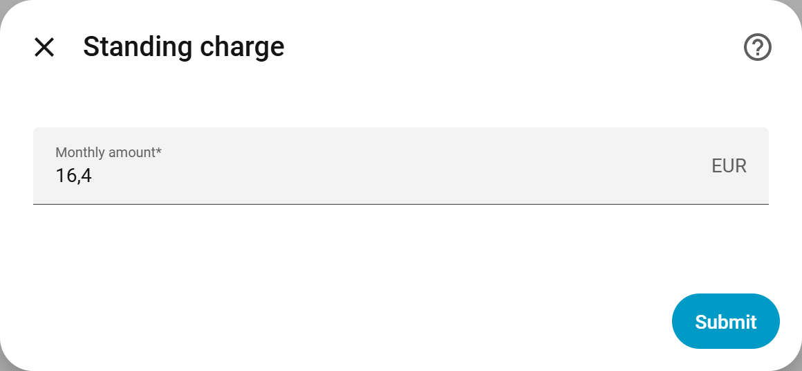

### The weather

Optional, but this is what makes the estimates much better in an electrically heated home. Ideally give both:

- the **outdoor thermometer** has a history: Wattendix learns at once from what Home Assistant already recorded;
- the **weather entity** provides the forecast for the coming days.

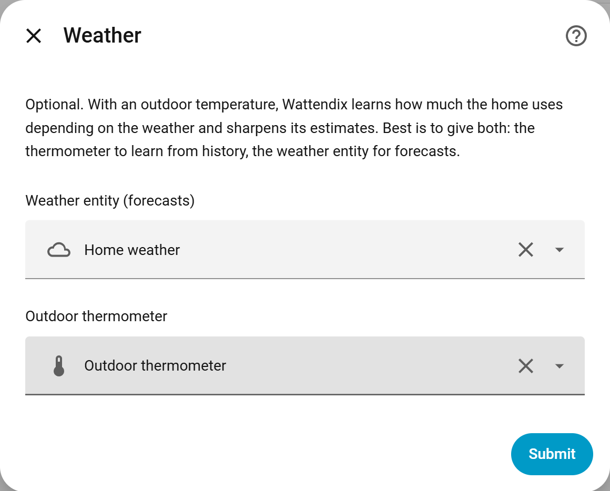

### Heating

Optional. With the consumption of your heat pump or heaters, Wattendix compares it with what the cold weather calls for.

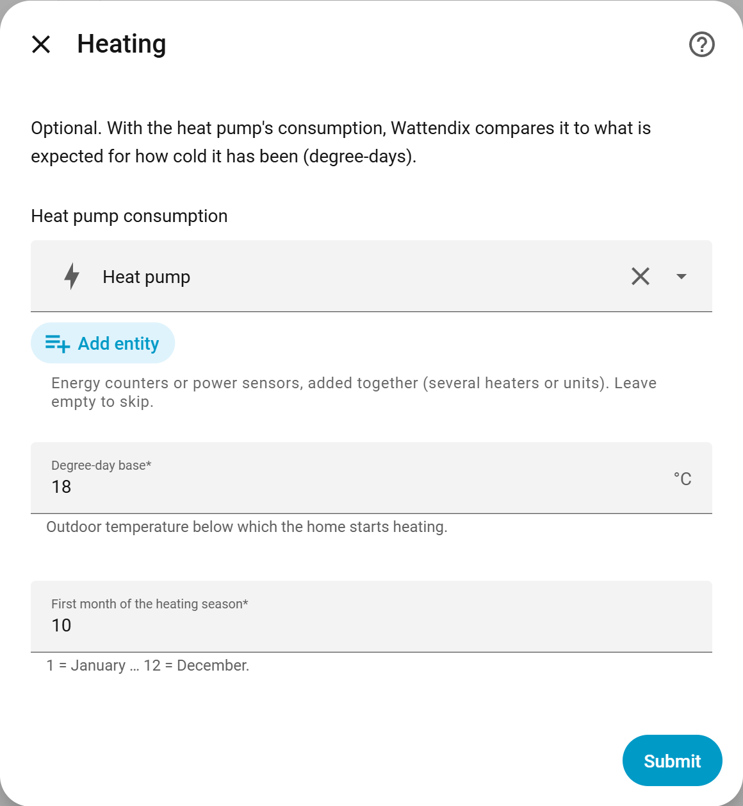

Everything can be changed later with *Configure* on the integration page, without losing the counters.

## 3. Add the card

On a dashboard: *Edit → Add card → Wattendix*. Nothing to add to the resources, the card comes with the integration. If it is missing from the list, reload the browser page.

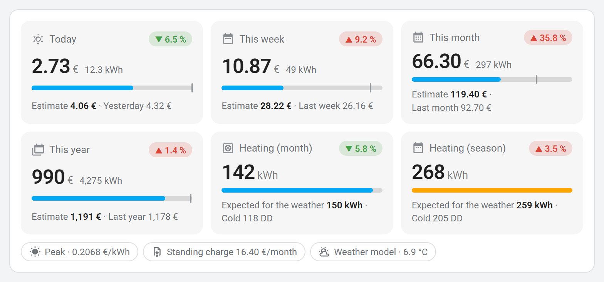

Each tile shows the amount so far, a bar moving towards the estimate (the small tick marks the previous period), and the trend against the previous period. Tap a tile to open its history.

The visual editor offers three layouts and a few options:

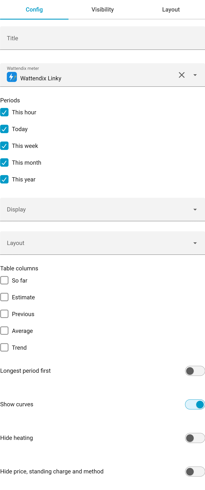

| Layout | Result |
| --- | --- |
| **Tiles** with *Show curves* | 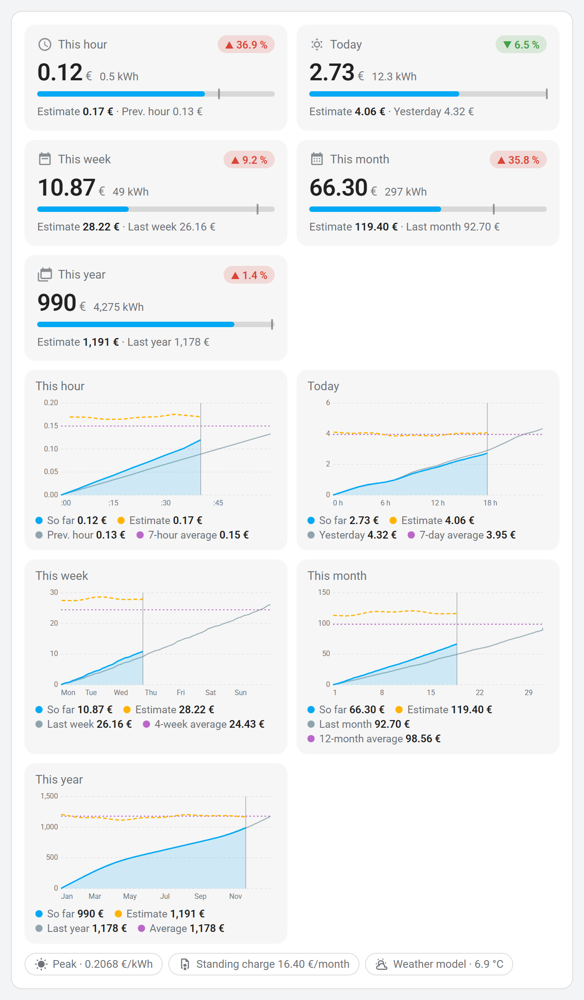 |
| **Summary table** | 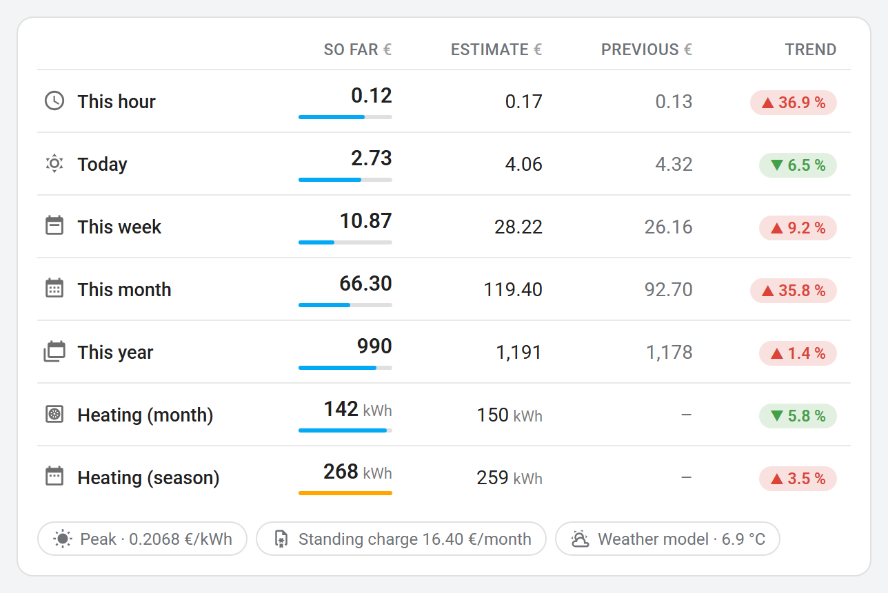 |
| **Mini table** | 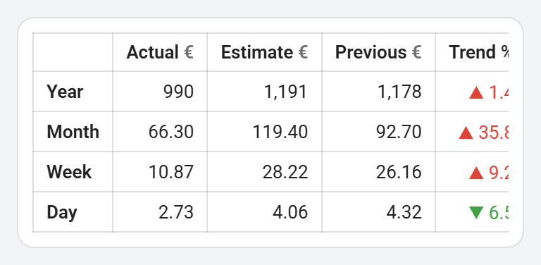 |

On the curves: blue is what has been used, dashed orange is the estimate over time, grey the previous period, purple the average.

The card adapts to what you configured:

| No price | Delayed source | Phone, dark theme |
| --- | --- | --- |
| 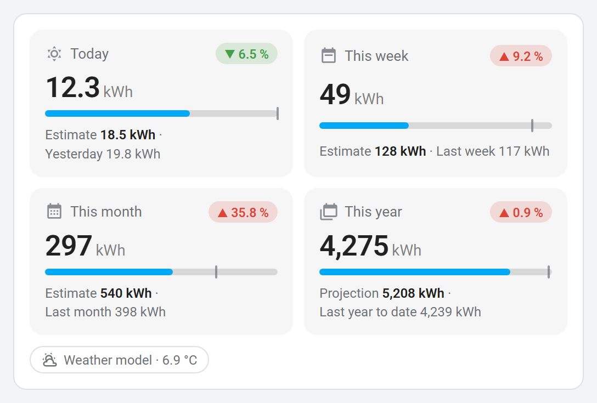 | 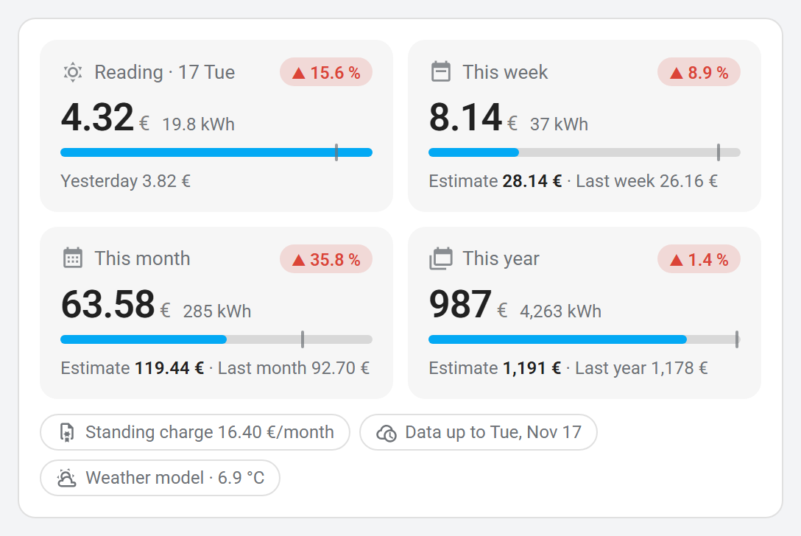 | 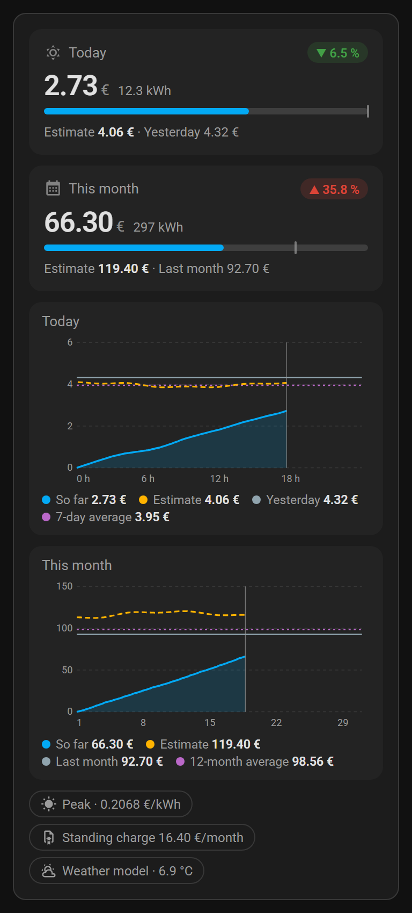 |

## 4. The first days

- **Counters are filled from day one**: Wattendix reads Home Assistant's history for the current and previous periods. Costs of that history are estimated at the rate in force on installation day.
- **The weather model needs 14 days of history with a temperature.** Until then the day's estimate uses the average of the last 7 days, and the card says so with an orange "learning" chip. With a thermometer that already has a history, the model is ready on first start.
- **The model is relearned every night**, with nothing to tune.

## Troubleshooting

| What you see | What to check |
| --- | --- |
| The card says Wattendix is not set up | The integration has not been added yet (step 2) |
| The card is not in the list | Reload the page; clear the browser cache if needed |
| Amounts at zero or missing | Is the consumption sensor available? Is its unit Wh, kWh, MWh, W or kW? |
| The estimate stays on "7-day average" | Fewer than 14 days of history, or no outdoor temperature |
| The *Rejected counter jumps* sensor goes up | The highest plausible power is too low, or the source sensor glitches |

A problem, an idea: [open an issue](https://github.com/Amify-Studio/wattendix/issues).
